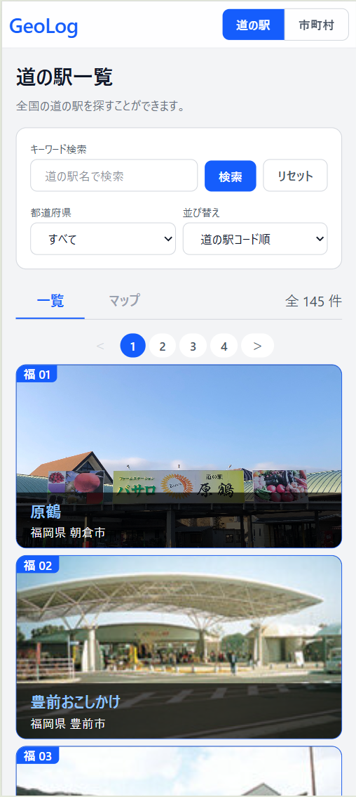
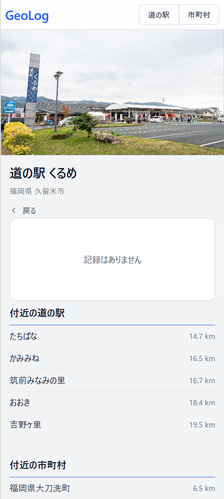
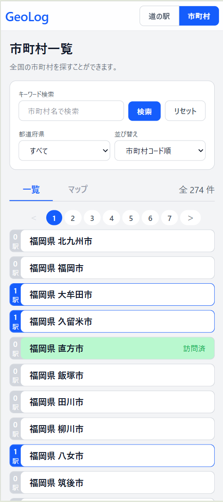
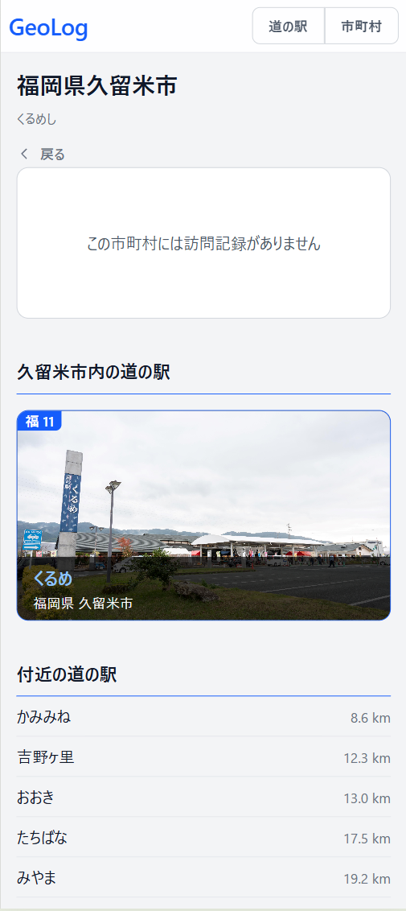
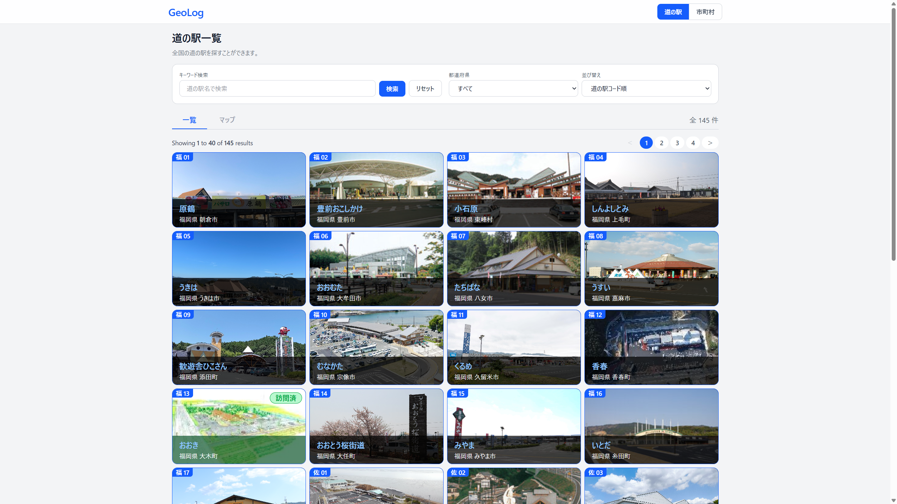
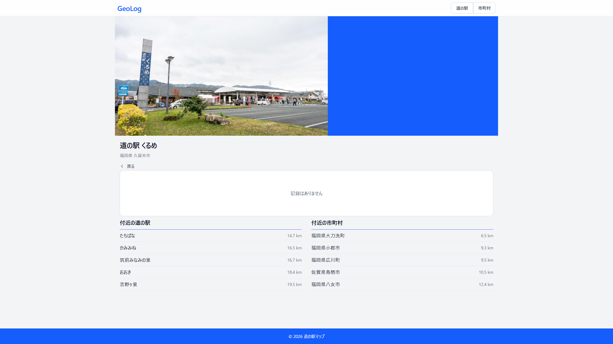
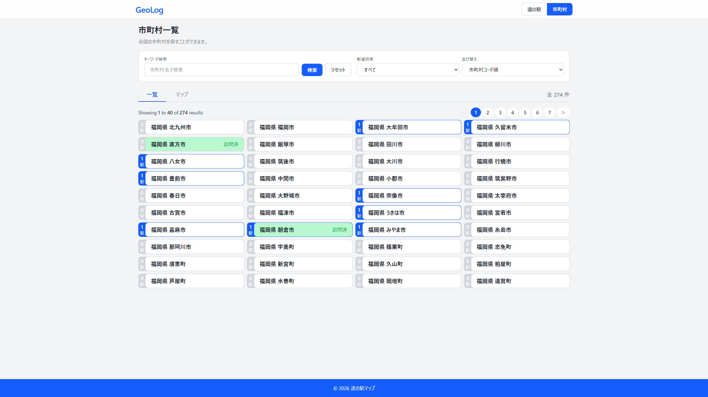
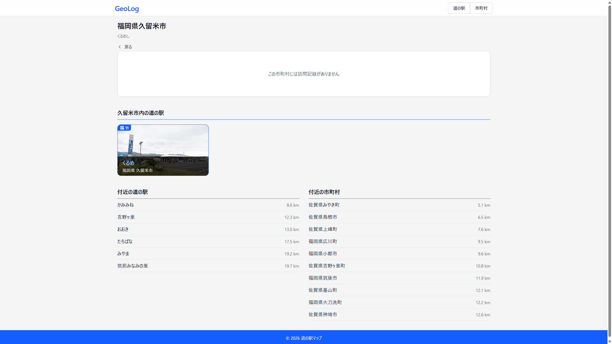
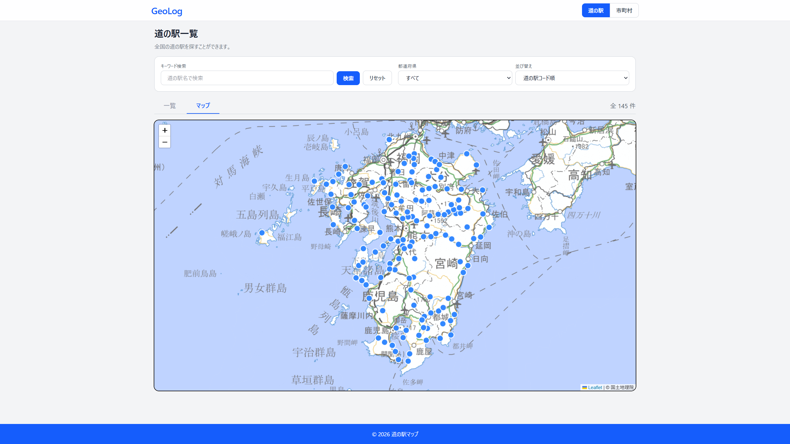
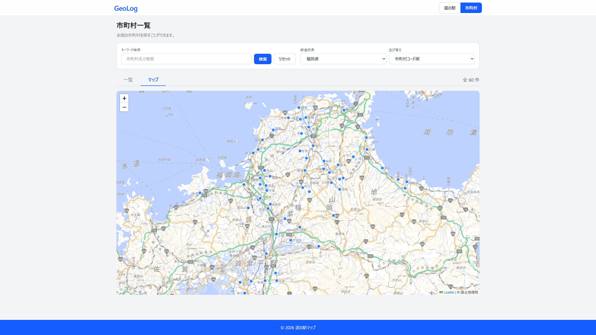

# 市町村と道の駅の来訪記録アプリ GeoLog

来訪記録アプリです。

## 主な機能
### 実装済機能
- 一覧画面から登録されている道の駅と市町村の閲覧。
- 市町村もしくは道の駅に対して写真とコメントを記録できる。
### 実装予定機能
- ダッシュボードで、進捗状況を確認できる。
- 位置情報と連携して、近くの道の駅や市町村を検索・ソートできる。

※現時点では九州沖縄のみデータ有

## 開発イメージ

### スマホ

<table>
    <tr>
        <td></td>
        <td></td>
        <td></td>
        <td></td>
    </tr>
</table>

### PC

<table>
    <tr>
        <td></td>
        <td></td>
    </tr>
    <tr>
        <td></td>
        <td></td>
    </tr>
    <tr>
        <td></td>
        <td></td>
    </tr>
</table>

## 動作環境
- Docker Desktop / Docker Compose
- 開発環境は Laravel Sail で構築

## 環境構築手順

### 1. リポジトリの clone

```bash
git clone <このリポジトリの URL>
cd <リポジトリ名>
```

### 2. 環境変数ファイルの作成

```bash
cp .env.example .env
```

### 3. 依存パッケージのインストール

```bash
docker run --rm \
    -u "$(id -u):$(id -g)" \
    -v "$(pwd):/var/www/html" \
    -w /var/www/html \
    laravelsail/php85-composer:latest \
    composer install --ignore-platform-reqs
```

### 4. コンテナの起動

```bash
sail up -d
```

### 5. アプリケーションの初期化

```bash
sail artisan key:generate
sail artisan storage:link
sail artisan migrate:fresh --seed
```
### 6. 緯度経度および画像の取得
初期データには住所と公式URLのみなので、GoogleAPIから緯度経度、URLから画像を取得する。
```bash
sail artisan cities:fetch-coordinates
sail artisan stations:fetch-coordinates
sail artisan stations:fetch-images
```

### 7. フロントエンドのビルド

```bash
sail npm install
sail npm run build
```

### 8. 動作確認

http://localhost にアクセス

